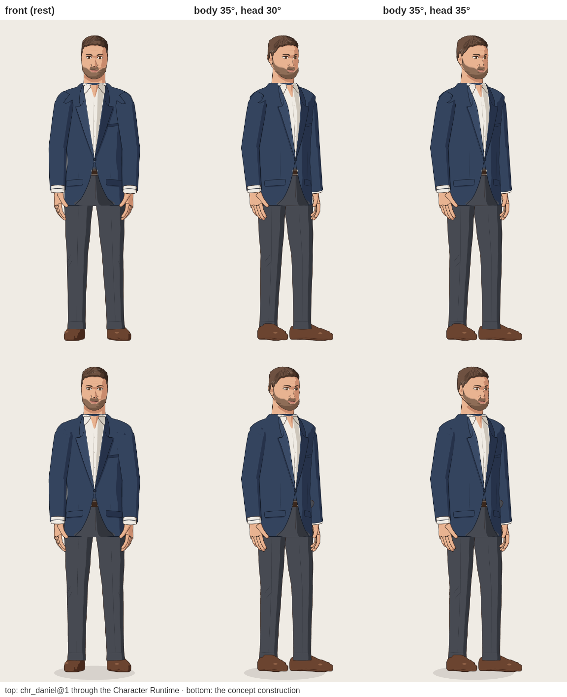
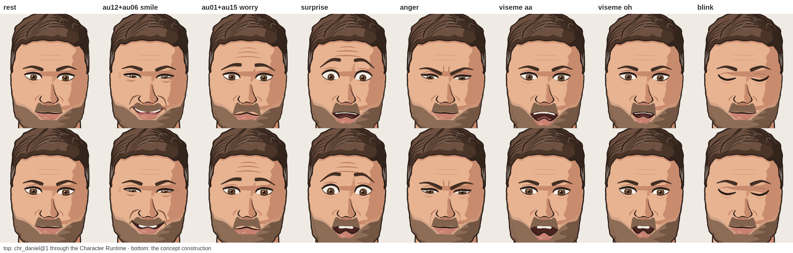
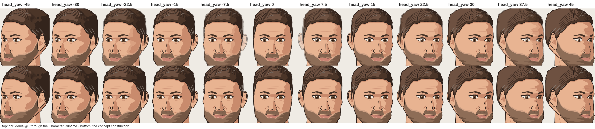
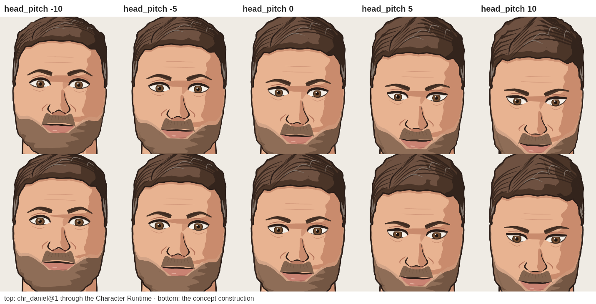
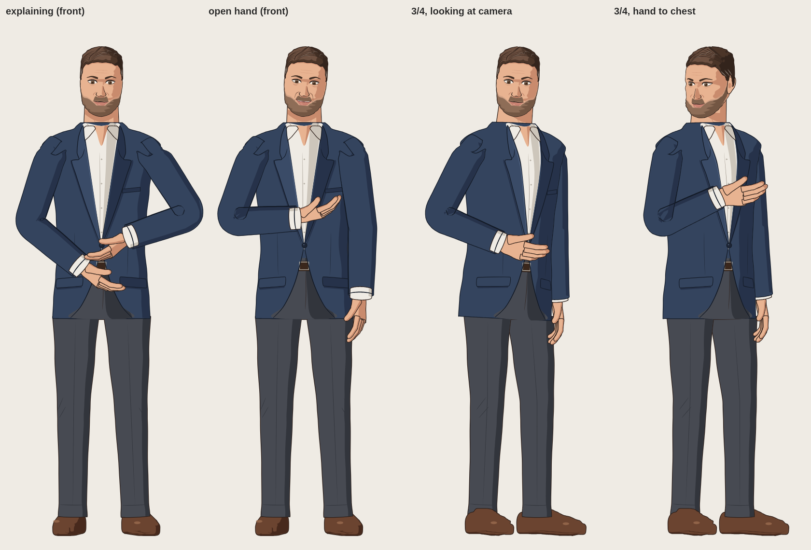
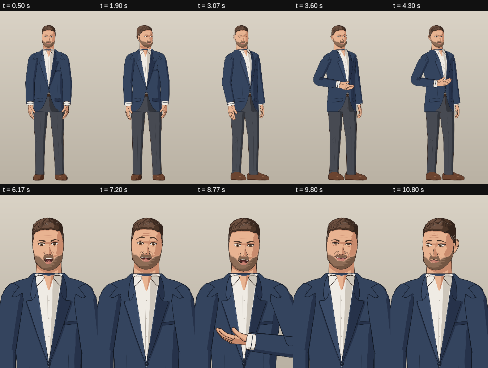

# Character System V1, Faza 3: `chr_daniel@1` nga koncepti v1 (kandidat për miratim)

**Dega:** `cl-3-daniel` (nga `proto-daniel-cartoon-v1`) · **Statusi:** paketa është ndërtuar, verifikuar dhe testuar. **Nuk është publikuar.** Pret miratimin e PO-së.

## 1. Përmbledhje

Ndërtova Daniel Vos si paketë `erkasa.character/1` nga konstruksioni i konceptit v1 të miratuar. Paketa ka trup të plotë, kokë me 7 pamje, rig fytyre me njësi FACS, vizema, blink dhe shikim, si edhe krahë të animueshëm. Ajo kalon validimin dhe self-check-un pa asnjë gjetje. Runtime-i e vizaton afër konceptit: në pozën bazë, diferenca mesatare është 1–2 nga 255.

|                              |                                                                                                |
| ---------------------------- | ---------------------------------------------------------------------------------------------- |
| Paketa                       | `library/characters/chr_daniel/1/`, 7.2 MB JSON (pa PNG, pa LFS)                               |
| Pjesë                        | 188 pjesë vektoriale, 88 117 kulme                                                             |
| Morph target-e               | 1178 morph target-e, 312 107 delta                                                             |
| Pamjet e kokës (`head_yaw`)  | −45, −30, −15, 0, 15, 30, 45                                                                   |
| Pamjet e trupit (`body_yaw`) | 0, 35                                                                                          |
| Kanalet e deklaruara         | 46, secili i provuar nga self-check-u                                                          |
| Fytyra                       | 11 AU, 15 vizema, blink l/r, shikim 3D, nofulla, vija shprehjeje që ndizen me AU-të            |
| Identiteti                   | burrë, 44 vjeç, 1809 mm, 7.03 kokë, mjekër, flokë me ndarje anash, gri te tëmthat              |
| Ndërtimi                     | ~50–60 s, determinist: dy ndërtime japin bajte identike                                        |
| Video-test                   | 12 s, 1080×1920, 30 fps. Runtime-i ka mesatarisht 2.4 ms vlerësim + 7.5 ms vizatim për kuadër. |

## 2. Si u ndërtua

```
koncepti v1 (3D → 2D)                          Character Builder                          Library
prototypes/daniel-cartoon-v1/bake.mjs   →   sources/tagged-svg.ts   (importues)     →   writer.ts → chr_daniel/1
  për çdo pamje: SVG i etiketuar               keys.ts                (morph target-e)    verifyPackage (self-check)
  në pushim + në çdo gjendje kyçe              sources/daniel.ts      (skeleti, kontrollet,
  (11 AU, nofulla, 2 blink, ±kthim, ±kokë)                             pamjet, sytë, fytyra)
```

1. **Bake mode në koncept.** `drawHead` dhe `figure` marrin opsionin `bake`. Me të, çdo grup del si `<g data-part data-bind data-morph>`.
   - Çfarë vizatohet vendoset sipas pozës qendrore të pamjes. Kështu çdo gjendje e një pamjeje ka të njëjtat pjesë.
   - Elementët me kusht (goja e hapur, vijat e buzëqeshjes, vijat e ballit) dalin në çdo gjendje. Opaciteti i tyre jepet nga një kontroll.
   - Dhëmbët, gjuha dhe hija e qepallës ndërtohen brenda hapjes, jo me clip. Kështu kanë të njëjtat kulme në çdo gjendje.
   - Goja e hapur del e mbyllur mbi vijën e gojës: pa sipërfaqe, pa asgjë të dukshme. Hapet plotësisht te nofulla 1.
   - Sytë: e bardha e syrit është pjesë më vete. Irisin e vizaton Runtime-i dhe e kthen drejt shikimit. Qepalla dhe vijat vizatohen sipër tij.
   - Pa `bake`, koncepti del **identik piksel për piksel** me atë të miratuar. E verifikova te të tre fletët.
2. **Importuesi (`tagged-svg.ts`)** i kthen path-et (M/L/C/Q/Z, rrathë, elipsa) në kulme dhe komanda të kontratës. Kurbat mbeten kurba.
   - Clip-i bëhet në kohën e ndërtimit me `polygon-clipping`, pastaj thjeshtohet me RDP, me tolerancë 0.1 mm.
   - Strokes me ngjyrën e mbushjes (vulat midis rajoneve) ndjekin konturin e prerë.
3. **Morph target-et (`keys.ts`)** krijohen në dy mënyra:
   - **exact:** kur pjesa rivizatohet pikë për pikë (sytë, vetullat, goja), target-i është diferenca e pikave.
   - **field:** konturi i kokës, rajonet e hijes dhe flokët rillogariten nga forma, prandaj pikat nuk korrespondojnë. Aty çdo pikë lëviz si pikat e formës 3D rreth saj (IDW me 6 fqinjë). Përdoret për kthimin dhe tundjen brenda pamjes dhe për rënien e mjekrës kur hapet nofulla.
   - Raporti i ndërtimit (`bake-report.json`) nuk ka asnjë rast fallback dhe asnjë target të kapërcyer.
4. **Skeleti.**
   - Kocka të përbashkëta: `root → pelvis → chest → neck → head`.
   - Çdo pamje trupi ka zinxhirin e vet për krahun: `arm_{l,r}_upper_{b0,b35}`, `arm_{l,r}_lower_…`, `hand_{l,r}_…`. Nyjet janë aty ku i vizaton ajo pamje.
   - Një kanal, p.sh. `arm_l_lower`, i lëviz të dy zinxhirët njësoj.
   - Peshat e lëkurës llogariten nga pozicioni përgjatë zinxhirit: shpatulla → bërryl → dore, me kalim të butë te bërryli dhe te shpatulla.

## 3. Çfarë ka paketa

- **Koka:** 7 pamje me 15° largësi midis tyre.
  - Brenda çdo pamjeje ka morph target-e për kthim ±7.5° (`head_yaw`) dhe për tundje ±10° (`head_pitch`; pozitivi do të thotë koka ulet).
  - Te kufiri i pamjeve ka cross-fade 2° në secilën anë.
  - `head_yaw` është këndi i kokës ndaj kamerës, jo ndaj trupit.
- **Trupi:** pamjet `b0` dhe `b35`, me cross-fade 1.5°. Kontrollet:
  - `spine_bend` (±5°), `chest_bend` (±8°), `breath` (morph në kraharor);
  - `neck_bend`, `head_roll`;
  - `arm_*_upper` (−15…80), `arm_*_lower` (0…120), `wrist_*_bend` (±30).
- **Fytyra.**
  - AU-të: `au01 au02 au04 au05 au06 au07 au10 au12 au15 au23 au24`.
  - `jaw_open`: morph i nofullës dhe i mjekrës; vija e gojës së hapur ndizet nga 0.04 në 0.2.
  - Vizemat `sil pp ff th dd kk ch ss nn rr aa e ih oh ou` jepen si pesha AU-sh + nofulla.
  - Vijat e shprehjes: ballit (au01, au02), mes vetullave (au04), buzëqeshjes (au12), këmbëzat e sorrës (au06).
  - Blink-u e mbyll hapjen nën 10%; e provon self-check-u.
  - Shikimi është 3D, me kufi 25°.
- **Pa veshje të ndërrueshme.** Kostumi është pjesë e trupit (`wardrobe: []`), pra versioni 1 ka një veshje fikse.
- **Pa duar me gishta, pa locomotion, pa interaksione.** Asgjë nga këto nuk është deklaruar.

## 4. Paketa kundrejt konceptit

Të njëjtat poza, njëherë nga paketa përmes Runtime-it (Skia) dhe njëherë nga konstruksioni i konceptit (resvg). Matja bëhet brenda zonës së vizatuar: diferenca mesatare RGB (0–255) dhe përqindja e pikselëve qartësisht të ndryshëm (> 40).

| Rasti                                             | Diferenca mesatare    | Pikselë qartësisht të ndryshëm |
| ------------------------------------------------- | --------------------- | ------------------------------ |
| Trupi, përballë, në pushim                        | 1.7                   | 0.2%                           |
| Trupi 35°, koka 30° / 35°                         | 3.1 / 3.0             | 1.4% / 1.4%                    |
| Koka në pushim                                    | 1.2                   | 0.6%                           |
| Buzëqeshje / shqetësim / zemërim / blink          | 1.8 / 1.2 / 1.1 / 0.9 | 1.2% / 0.6% / 0.5% / 0.4%      |
| Habi (4 njësi + nofulla 0.5) / vizema aa / oh     | 3.7 / 2.9 / 2.9       | 3.0% / 1.9% / 1.9%             |
| Koka në çdo pamje (−45…45)                        | 1.2–1.3               | 0.6–0.7%                       |
| Koka midis pamjeve, te kufiri (±7.5, ±22.5, 37.5) | 6.1–8.8               | 3.6–6.4%                       |
| Koka e ulur ose e ngritur ±5 / ±10                | 3.8–4.6 / 5.6–6.8     | 2.4–3.3% / 3.9–5.3%            |

Te kufiri i pamjeve është rasti më i keq, sepse dy pamje përzihen 50/50. Shiko §7.






Poza që koncepti nuk i vizatoi kurrë, vetëm nga Runtime-i, me gjeste në zinxhirët e krahëve në të dy pamjet:



## 5. Testi i animacionit

`character/demo/out/chr-daniel-demo.mp4`: 12 s, 1080×1920, 30 fps, me cilësimet FFmpeg të pipeline-it. Track-et janë `erkasa.render/1`, siç do t'i shkruante një Engine. Lëvizjet e lëmuara shkruhen si samples të dendur, sepse `keys` në kontratë njohin vetëm `linear` dhe `hold`.

**Plani i plotë (0–5.4 s):**

- sytë çojnë shikimin dhe koka ndjek 0 → 30°, duke kaluar 3 pamje;
- trupi kthehet 0 → 35° → 0, me koken nga kamera dhe me gjest me dorën e afërt;
- frymëmarrje dhe blink gjatë gjithë kohës.

**Plani mesatar (5.4–12 s):**

- një fjali mbi vizema: „So why do we stay? … Because it matters.“;
- vetullat ngrihen në theksim, koka tundet dhe anon, dora shpjegon;
- pastaj buzëqeshje (au12 + au06);
- pastaj shqetësim (au01 + au15), me shikim poshtë majtas dhe kokë −15°.

Dy render-a të videos dolën me bajte identike.



## 6. Matjet

|                                    |                                                                                                  |
| ---------------------------------- | ------------------------------------------------------------------------------------------------ |
| Vlerësimi (`evaluate`)             | p50 2.4 ms, p95 10.4 ms                                                                          |
| Vizatimi                           | p50 7.5 ms, p95 47 ms. Plani i plotë: p50 7.3 ms. Plani mesatar: p50 7.6 ms.                     |
| Kuadrot me cross-fade (20 nga 360) | p50 55 ms, max 140 ms. Vizatohen dy shtresa 1080×1920 jashtë ekranit dhe pastaj përzihen.        |
| Gjithsej me kodimin                | 42.8 ms për kuadër (15.4 s për 12 s video)                                                       |
| Memoria                            | +133 MB në fillim (canvas-et e pool-it dhe ngarkimi), pastaj e qëndrueshme: 449 → 481 MB në 12 s |
| Madhësia                           | 7.2 MB JSON. Çdo pamje koke ~0.9 MB, çdo pamje trupi ~0.48 MB.                                   |
| Ndërtimi                           | ~50–60 s, kryesisht llogaritja e target-eve `field`                                              |

## 7. Kufizimet që shihen

1. **Duart janë të ngurta.** Gishtat nuk lëvizin (`hands.fingers: false`). Dora e varur rrotullohet me parakrahun, kështu që në gjeste duket si pëllëmbë e sheshtë anash.
   - Hapi tjetër natyral: një bibliotekë pozash dore, 6–8 vizatime për çdo pamje, të ndërrueshme me opacitet.
2. **Krahët lëvizin vetëm në planin e figurës.** Në pamjen përballë, parakrahu nuk mund të vijë drejt kamerës (foreshortening). Gjestet „dora para gjoksit“ duken si krah që kalon përpara barkut.
   - Ngritja anash mbi ~60° deformon shpatullën.
3. **Trupi ka vetëm dy pamje.** Kthimi 0 → 35° është kërcim, i zbutur nga cross-fade-i 1.5° (1–2 kuadra në një kthim normal).
   - Nuk ka `body_yaw` negativ dhe nuk ka morph kthimi brenda pamjes së trupit.
   - Zgjidhja: pamje 15° / 25° ose target-e `field` edhe për trupin, me të njëjtën metodë si koka.
4. **Te kufiri i pamjeve të kokës, koka shfaqet dyfish për ~4°.** Veshi shfaqet gradualisht dhe konturi duket pak dyfish. Në lëvizje zgjat 1–2 kuadra.
   - Konturi dhe flokët brenda pamjes ndjekin formën me përafrim (`field`): silueta rrëshqet mbi formë.
5. **AU-të janë simetrike.** Konstruksioni lejon shprehje asimetrike (L/R), por kanalet `x_` për to nuk i kam shtuar.
6. **`au23` zëvendëson buzët e rrumbullakosura** (o / u), sepse kontrata nuk ka AU18 / AU22.
   - `au12` sjell edhe pak ngushtim syri (buzëqeshja e konceptit), pra nuk është FACS e pastër.
   - Çdo vijë shprehjeje ndizet nga një njësi e vetme, sepse drive-t e opacitetit shumëzohen.
7. **Irisi i Runtime-it është më i thjeshtë se ai i konceptit.** Nuk ka unazë të ngrohtë të brendshme. Shkëlqimi është i fiksuar te syri.
8. **Këmbët janë statike.** Nuk ka kanale këmbësh, `sockets`, `contacts` ose `hands`.
9. **Koncepti mbetet burimi.** Konstruksioni jeton në `prototypes/daniel-cartoon-v1/` (JS pa tipe) dhe Builder-i e importon. Nëse miratohet, mund të bartet në `character/src/builder/sources/daniel/`.

## 8. Ndryshime jashtë paketës

- **Runtime, revizioni 2.** Kanalet e vizemave tani konsumohen nga rig-u i fytyrës (`face.visemes`), pa kontroll të vetin.
  - Në Fazën 2, një paketë me vizema nuk mund të merrte `viseme_*`: Runtime-i i refuzonte si `CHANNEL_UNKNOWN`.
  - `chr_test_minimal@1` nuk ndryshon (nuk ka vizema).
  - Kam shtuar test.
- **Builder:**
  - `sources/tagged-svg.ts` është importuesi i përgjithshëm për artë të etiketuar. Ky është kufiri ku do të hyjnë edhe skedarët e artistëve.
  - `keys.ts` krijon target-et `exact` dhe `field`.
  - `sources/daniel.ts` dhe `build-daniel.ts` (`pnpm --filter @erkasa/character build:daniel`) ndërtojnë Daniel-in.
  - Dependency e re për zhvillim: `polygon-clipping@0.15.7`.
- **Prototipi:**
  - `bake.mjs` është i ri.
  - `face.mjs`, `figure.mjs` dhe `head.mjs` kanë bake mode, si dhe parametrat `pucker` dhe `blink`.
  - `lib.mjs` ka `pngOf`.
  - Pa `bake`, output-i nuk ndryshon.

## 9. Kontrollet

- Testet e repos kalojnë të gjitha: 1441 teste (`character` ka 96, mes tyre 12 të reja për importuesin, target-et dhe Daniel-in).
- `typecheck`, `eslint` dhe `prettier --check` kalojnë.
- Paketa del pa gjetje nga `verifyPackage`.
- Ndërtimi është determinist (`character.json` i njëjtë në dy ndërtime). Video-testi është determinist.
- Fletët e konceptit janë identike me ato të miratuara.

## 10. Vendimet për PO-në

1. **Pamja:** a pranohet `chr_daniel@1` ashtu siç duket në fletët e mësipërme dhe në video?
   - Nëse po: e shënoj `approval: approved` (nga ju, me datë), e rindërtoj dhe e publikoj në katalog.
   - Para publikimit ajo nuk mund të përdoret nga pipeline-i përmes një reference të pandryshueshme. Store-i refuzon publikimin e një karakteri `reference` pa miratim.
2. **Hapi tjetër,** në rendin që propozoj:
   - **(a)** pozat e dorës;
   - **(b)** pamje të ndërmjetme trupi ose kthim `field` për trupin;
   - **(c)** kanale asimetrike `x_` për fytyrën;
   - **(d)** bartja e konstruksionit nga `prototypes/` në Builder.
3. **Kufiri me Engine-t:** asgjë nga kjo nuk prek Engine-t. Daniel nuk është i lidhur ende me Character Acting (W1 / W2).

## 11. Skedarët

- `library/characters/chr_daniel/1/` (paketa, e pa publikuar)
- `character/src/builder/sources/tagged-svg.ts`
- `character/src/builder/keys.ts`
- `character/src/builder/sources/daniel.ts`
- `character/src/builder/build-daniel.ts`
- `character/src/runtime/{evaluate,validate,revision}.ts`
- `character/test/{builder-keys,daniel}.test.ts`, `character/test/face.test.ts` (vizemat)
- `character/demo/daniel-demo.ts`, `character/demo/daniel-check.ts`
- `character/demo/out/chr-daniel-demo.mp4`, `-contact.png`, `-stats.json`
- `prototypes/daniel-cartoon-v1/{bake,face,figure,head,lib}.mjs`
- `docs/reports/cl-3/`:
  - `README.md`;
  - `body.png`, `expressions.png`, `head-turn.png`, `head-pitch.png`, `poses.png`;
  - `compare.json`, `bake-report.json`.
