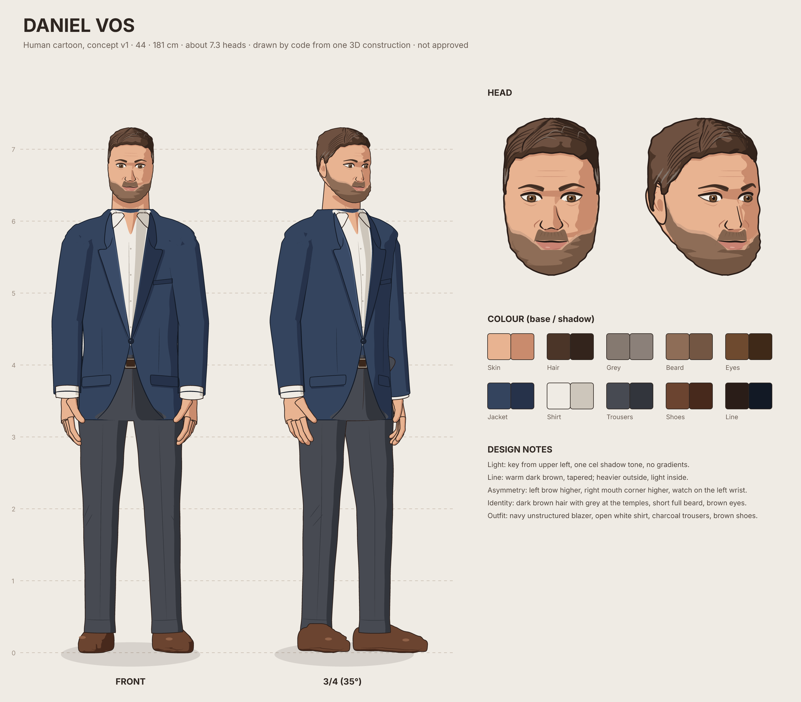
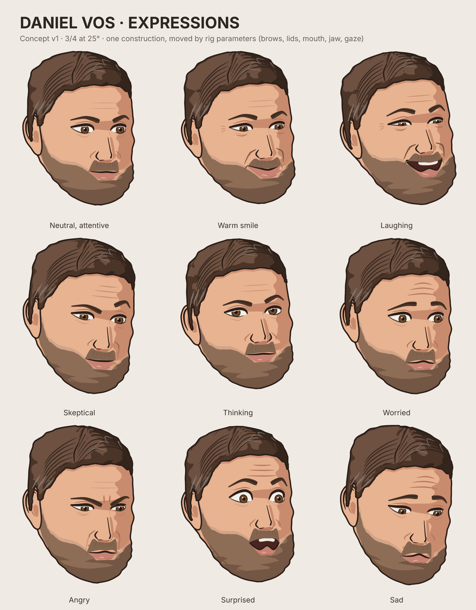
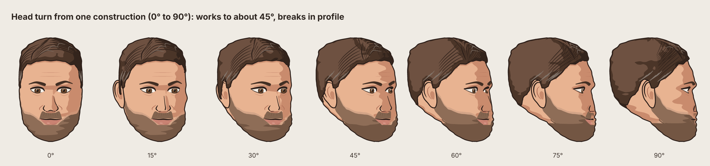

# Daniel Vos, Human Cartoon V1: koncepti vizual dhe vlerësimi

20 nëntor 2026. Branch `proto-daniel-cartoon-v1`, mbi `plan-character-art-standard`.

**Çfarë përmban ky raport:**

- vetëm koncepti vizual, për miratimin tënd;
- nuk është prekur kodi ekzistues, asnjë kontratë, asnjë Engine;
- nuk ka rig, paketë apo animim.

Prototipi është në `prototypes/daniel-cartoon-v1/`.

Shenjat: **[F]** e verifikuar · **[M]** e matur · **[S]** vlerësim · **[R]** rekomandim.

---

## 0. Përmbledhja

1. **Çfarë dorëzoj.** Tri imazhe në `prototypes/daniel-cartoon-v1/out/`:
   - **Model sheet** (`daniel-model-sheet.png`):
     - full body nga fronti dhe në 3/4 (35°);
     - vijat e lartësisë sipas kokave;
     - koka nga afër, në front dhe në 3/4;
     - paleta dhe shënimet e dizajnit.
   - **Expression sheet** (`daniel-expressions.png`): 9 shprehje në 3/4.
   - **Testi i kthimit të kokës** (`daniel-head-turn.png`): nga 0° në 90°, si dëshmi për vlerësimin.
2. **Si u ndërtua.** Daniel nuk është vizatuar dy herë. Front-i dhe 3/4 dalin nga **i njëjti ndërtim 3D**:
   - **Format e trupit dhe të veshjeve.** Çdo formë është një "tub" i vazhdueshëm unazash: mënga me bërrylin, këmba e pantallonave, trupi i xhaketës.
   - **Koka.** Prerje horizontale, plus pika 3D për sytë, hundën, gojën, veshët, mjekrën dhe flokët.
   - **Konturet dhe hijet.** Të dyja dalin nga e njëjta formë.
   - **Vija e ngjyrës.** Del vetëm në skajin e jashtëm të çdo veshjeje, prandaj trupi lexohet si një i tërë dhe jo si pjesë të lidhura me nyje.
3. **Gjykimi im për cilësinë.** Daniel lexohet si një burrë i vetëm, koherent, në stil cartoon për të rritur.
   - Anatomia dhe proporcionet (rreth 7.3 koka) janë të besueshme. Front-i dhe 3/4 janë i njëjti person. Shprehjet lexohen.
   - **Por nuk është ende në nivelin e një seriali premium të animuar.**
     - Fytyra është ende e përgjithshme.
     - Flokët duken si helmetë.
     - Duart janë të thjeshta.
     - Këpucët dhe pantallonat janë të ngurta.
   - Profili dhe pamja nga pas nuk janë bërë. Detajet janë te §3.
4. **A animohet me sistemin aktual?**
   - **Po, për pjesën më të madhe të asaj që i duhet Erkasa-s:**
     - kthimi i kokës deri rreth 45°;
     - shikimi dhe pulitja;
     - shprehjet;
     - lëvizjet e krahëve dhe gjestet;
     - përkulja e trupit.

     Kjo kërkon një hap "pjekjeje" (bake) në Builder, që e kthen ndërtimin 3D në paketë `erkasa.character/1`. **Kontrata nuk ka nevojë të ndryshohet.**

   - **Ende jo:** profili, pamja nga pas, ulja dhe ecja e provuar. Shih §4.
5. **Para çdo rig-u kam nevojë për 3 vendime nga ti** (§6).







---

## 1. Character System V1: çfarë mbështet për këtë stil

Stili "Professional Human Cartoon" është vektorial: vija me ngjyrë, ngjyra të plota dhe një ton hijeje. Ky është formati që Character System V1 mbështet më mirë, sepse s'ka nevojë për tekstura të pikturuara.

| Nevoja e stilit                                              | Character System V1                                                                 | Statusi                                                                                |
| ------------------------------------------------------------ | ----------------------------------------------------------------------------------- | -------------------------------------------------------------------------------------- |
| Forma vektoriale me kthesa (fill, stroke, gradient)          | Pjesët vektoriale të `erkasa.character.parts/1` (M, L, Q, C, Z)                     | **[F]** e testuar në Fazën 2                                                           |
| Vija që hollohen në skaje                                    | Ruhen si forma të mbushura (kontur i plotë), jo si stroke                           | **[F]** pa ndryshim                                                                    |
| Vijë vetëm në skajin e jashtëm të veshjes (trup i integruar) | Dy shtresa për pjesë: vija poshtë, ngjyra sipër, me `z`                             | **[F]** pa ndryshim kontrate                                                           |
| Mëngë dhe këmbë që përkulen pa tegel                         | Skinning me ≤ 4 kocka për kulm, morph targets                                       | **[F]** e testuar te karakteri testues                                                 |
| Bërryl dhe gju pa u holluar                                  | Morph korrigjues, të drejtuar nga i njëjti kanal                                    | Në kontratë; **e paprovuar**                                                           |
| Hije cel që ndjekin formën                                   | Pjesë vektoriale me të njëjtat pesha si forma. Skajet e sakta priten në Builder     | Pa ndryshim kontrate                                                                   |
| Hije që ndryshojnë me anën e dritës së skenës                | Nuk ekziston                                                                        | Rregull stili: drita kryesore në anën e vizatuar. Ose K4 nga propozimi i mëparshëm     |
| Kthimi i kokës dhe i trupit                                  | Pamje sipas yaw, morph-e këndi ±15°, brez kalimi                                    | **[F]** e testuar me 2 pamje koke. Pamjet e trupit janë në kontratë, **të paprovuara** |
| Sy: sklerë, iris, bebëz, qepalla, shikim                     | Irisi në sferën e syrit, i prerë nga sklera; pulitje majtas dhe djathtas; shikim 3D | **[F]** e testuar. Është i njëjti model syri si në koncept                             |
| Shprehjet                                                    | 18 AU si morph targets                                                              | **[F]** mekanizmi është testuar me 5 AU                                                |
| Vija shprehjeje (balli, cepat e syve, hunda-goja)            | Pjesë me `opacity` të drejtuar nga kanali                                           | **[F]** mekanizmi ekziston                                                             |
| Goja e hapur me dhëmbë dhe gjuhë                             | Kocka e nofullës + pjesë me `opacity`                                               | **[F]** mekanizmi ekziston                                                             |
| Lip-sync                                                     | 15 visema si përzierje AU                                                           | Në kontratë; **e paprovuar** te një karakter                                           |
| Duar me 5 gishta dhe nyje                                    | ≤ 3 kocka për gisht, socket `grip`                                                  | Në kontratë; **e paprovuar**                                                           |
| Ecje, ulje, kontakt me tokën                                 | Kockat e këmbëve, `contacts`                                                        | Në kontratë; **e paprovuar**                                                           |
| Veshja që fsheh trupin                                       | Outfit me pjesët që mbulon                                                          | **[F]** e testuar                                                                      |

**Performanca:**

- Karakteri testues, vetëm me vektor, vizatohet në **3.7 ms për kuadër** [M].
- Daniel do të ketë rreth 10 herë më shumë pjesë, kështu që pres **15–40 ms për kuadër** [S]. Kjo duhet matur te paketa e vërtetë.
- Për këtë stil, **pothuajse asnjë nga shtesat K1–K5 të propozimit pikturor nuk nevojitet**.
  - K5, pamja nga pas, do të nevojitej për turnaround të plotë.
  - K2, `clipTo`, do ta thjeshtonte hijen, por mund të zëvendësohet duke i prerë hijet në Builder.

---

## 2. Si u ndërtua koncepti

Prototipi është vetëm për koncept dhe nuk është kod produksioni:

| Skedari                                                   | Çfarë bën                                                                                                                                        |
| --------------------------------------------------------- | ------------------------------------------------------------------------------------------------------------------------------------------------ |
| `tube.mjs`                                                | Tub nga unaza 3D. Llogarit konturin në çdo kënd, zonat e hijes (marching squares mbi rrjetin e unazave) dhe pikat mbi sipërfaqe                  |
| `body.mjs`                                                | Poza: kockat e trupit me pak contrapposto, xhaketa, mëngët, pantallonat, këpucët, qafa                                                           |
| `head.mjs`                                                | Masa e kokës nga prerje horizontale, me mollëza, kockë vetullash dhe vëllimin e mjekrës. Pikat 3D të fytyrës, asimetria, parametrat e shprehjeve |
| `face.mjs`                                                | Vizatimi i kokës: mjekra, sytë, vetullat, hunda, goja, mustaqet, veshët, flokët me thinja, vijat e shprehjeve                                    |
| `hand.mjs`                                                | Dora me 5 gishta: 3 segmente për gisht, 2 për gishtin e madh                                                                                     |
| `outfit.mjs`                                              | Xhaketa: jakat, këmisha e hapur, kopsa, xhepat, hapja poshtë kopsës me rripin                                                                    |
| `figure.mjs`, `expressions.mjs`, `turn.mjs`, `sheets.mjs` | Figura, shprehjet, testi i kthimit, fletët                                                                                                       |

**Si i riprodhon:**

```
cd prototypes/daniel-cartoon-v1
node sheets.mjs
```

Fletët dalin në rreth 2 sekonda dhe janë deterministe.

**Shprehjet** janë 12 parametra mbi të njëjtat pika: vetullat (lart, brenda, poshtë), qepallat, ngushtimi i syve, cepat e gojës (buzëqeshje, trishtim), shtrëngimi i buzëve, nofulla dhe shikimi. Ky është i njëjti fjalor që përdor rig-u: çdo parametër bëhet morph target ose kockë.

---

## 3. Vlerësimi i cilësisë

**Çfarë funksionon:**

- **Identiteti nga fronti në 3/4 është i njëjti person** [F], sepse të dyja pamjet dalin nga i njëjti ndërtim.
- **Trupi është i integruar:**
  - mënga është një formë e vetme nga supi te kyçi;
  - xhaketa ka një kontur të vetëm;
  - vijat e brendshme dalin vetëm aty ku krahu prek trupin dhe në bërryl;
  - nuk ka nyje të dukshme.
- **Proporcionet:**
  - rreth 7.3 koka;
  - supet dhe legeni në raport të besueshëm;
  - duart në përmasë reale kundrejt fytyrës.
- **Fytyra:**
  - sy me sklerë, iris, bebëz dhe qepalla;
  - vetulla të dizajnuara;
  - hundë me urë, majë dhe vrima;
  - mjekër e shkurtër me mustaqe;
  - asimetria e identitetit: vetulla e majtë më lart, buzëqeshja më e ngritur djathtas, ora në dorën e majtë.
- **Shprehjet lexohen në madhësi telefoni:** buzëqeshja, të qeshurit, zemërimi, habia, shqetësimi, trishtimi. Skepticizmi dhe të menduarit janë më delikatë.

**Çfarë nuk e arrin ende standardin (e them hapur):**

1. **Fytyra është ende e përgjithshme.**
   - Koka është pak në formë veze.
   - Mjekra është një masë e rëndë dhe e sheshtë.
   - Hunda dhe goja janë të thjeshta.

   Si tërësi, të kujton më shumë ilustrim vektorial "explainer" se sa një personazh studioje me karakter.

2. **Flokët** kanë masë, thinja dhe drejtim, por silueta e tyre është ende si helmetë. Mungon dizajni i formës, p.sh. kaçurrela ose lëvizje mbi ballë.
3. **Duart** kanë pesë gishta dhe nyje, por gishtat janë si cilindra. Nuk ka fletë pozash të dorës.
4. **Këpucët** nga fronti janë si blloqe. **Pantallonat** janë tuba të ngurtë, me pak palosje. **Poza** është neutrale dhe e ngurtë, si fletë modeli.
5. **Profili dhe pamja nga pas mungojnë.** Testi i kthimit (imazhi i tretë) tregon që:
   - deri rreth **45°** ndërtimi mban;
   - nga **60° në 90°** prishet, sepse hunda dhe buzët nuk janë pjesë e masës së kokës, dhe profili del i sheshtë.
6. **Hijet llogariten nga forma**, prandaj janë të qëndrueshme. Por ndonjëherë janë mekanike, si brezat e drejtë mbi këmbë. Një artist do t'i dizajnonte.

**Gjykimi im:** ky është niveli maksimal që arrita me kod në këtë seancë, dhe është i dobishëm si ndërtim. **Nuk e paraqes si dizajn final.** Diferenca kryesore është te tërheqja e fytyrës dhe e flokëve, jo te anatomia apo teknika. Për këtë propozoj dy rrugë (§6).

---

## 4. A mund të animohet natyrshëm?

| Lëvizja                              | Me Character System V1       | Çfarë duhet                                                                                                                                        |
| ------------------------------------ | ---------------------------- | -------------------------------------------------------------------------------------------------------------------------------------------------- |
| Kthimi i kokës 0–45°                 | **Po**                       | Pamjet 0°, ±30° të "pjekura" nga i njëjti ndërtim, plus morph-e këndi ±15°. Kontrata e mbështet                                                    |
| Kthimi deri në profil, pamja nga pas | **Jo ende**                  | Hunda dhe profili i buzëve në masën e kokës (punë ndërtimi), ose një profil i vizatuar. Për pamjen nga pas: K5 ose dy pamje me pjesë të dyfishuara |
| Shikimi, pulitja                     | **Po**                       | I njëjti model syri si në Runtime: irisi në sferë, i prerë nga sklera                                                                              |
| Shprehjet                            | **Po**                       | Çdo parametër i konceptit bëhet morph target i AU-ve përkatëse                                                                                     |
| Lip-sync                             | **Po, në parim**             | Duhen dizajnuar format e gojës për visemat. Mustaqet e mbulojnë buzën e sipërme, prandaj buza e poshtme dhe nofulla mbajnë leximin                 |
| Supet, krahët, bërrylat, kyçet       | **Po**                       | Mënga është tub i vazhdueshëm, pra skinning pa tegel. Morph korrigjues për bërrylin                                                                |
| Gjestet me duar, kapja               | **Pjesërisht**               | Kockat e gishtave ekzistojnë në ndërtim. Pozat e dorës (tregim, kapje, numërim) duhen dizajnuar dhe provuar                                        |
| Përkulja e trupit, frymëmarrja       | **Po**, për lëvizje mesatare | Pesha të buta në shtyllë. Palosjet e xhaketës si korrigjues                                                                                        |
| Ecja                                 | **E paprovuar**              | Këmbët janë tuba të vazhdueshëm me gju. Duhen pamjet e trupit në profil, palosjet e pantallonave dhe kontaktet e këmbëve                           |
| Ulja                                 | **Jo ende**                  | Kërkon pozë të dizajnuar: xhaketa mbi kofshë dhe pantallonat në gju. Ka gjasa të duhet zëvendësim vizatimi                                         |

**Pika teknike kryesore është hija.** Në koncept hijet llogariten për çdo pozë. Në rig ka dy rrugë:

- **"Pjekur" [R]:**
  - hijet janë forma që deformohen bashkë me trupin;
  - funksionojnë për lëvizje të vogla dhe mesatare;
  - për pozat e mëdha duhen korrigjues ose zëvendësime.
- **Rillogaritje nga ndërtimi 3D gjatë render-it:**
  - hije të sakta në çdo kënd dhe ndonjë kënd i ndërmjetëm falas;
  - por kërkon një lloj të ri pjese në kontratë dhe një rrugë të re vizatimi në Runtime;
  - kjo është ndryshim i madh dhe nuk e propozoj për v1.

---

## 5. Çfarë nuk bëra

- Nuk krijova rig, paketë `chr_daniel` apo animacion.
- Nuk ndryshova kontratat, Runtime-in, Library-n, Builder-in apo Engine-t.
- Shtova vetëm dosjen `prototypes/daniel-cartoon-v1/` dhe këtë raport.

---

## 6. Vendimet që duhen nga ti

1. **Drejtimi i stilit.** A është ky drejtimi "Professional Human Cartoon" që kërkon?
   - Nëse po, më thuaj çfarë të ndryshoj konkretisht: më shumë ose më pak stilizim në fytyrë, mjekër më e shkurtër ose më e gjatë, flokët, veshja, ngjyrat.
2. **Si ta ngremë cilësinë e fytyrës dhe të flokëve:**
   - **(a)** edhe 2–3 përsëritje nga unë, me komentet e tua;
   - **(b) [R]** një ilustrues bën një korrigjim sipër këtyre fletëve (front, 3/4, gjashtë shprehje), dhe unë i fus korrigjimet në ndërtim.

   Rruga (b) e mbyll më shpejt diferencën e tërheqjes vizuale, sepse ndërtimi, konsistenca dhe animimi mbeten tonat.

3. **Hapi pas miratimit të dizajnit** (vetëm me miratimin tënd):
   - **Slice-i i Danielit:** pamjet front dhe 3/4 "të pjekura" në `erkasa.character/1`, rig-u i fytyrës nga të njëjtët parametra, dhe një test animimi (fjalë, gjest, kthim koke), me matje.
   - Profili, pamja nga pas, ecja dhe ulja vijnë pas tij.

**Ndalem këtu.** Nuk kaloj në rigging pa miratimin tënd për dizajnin vizual.
